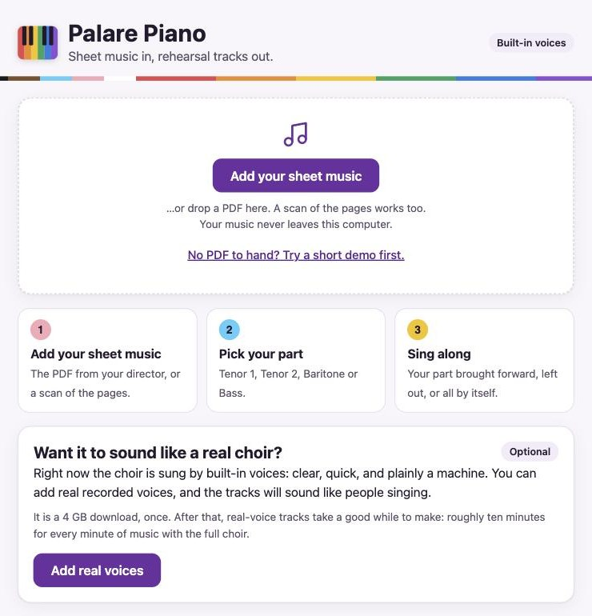
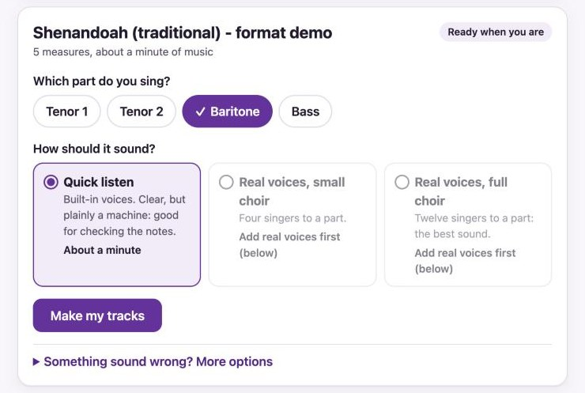
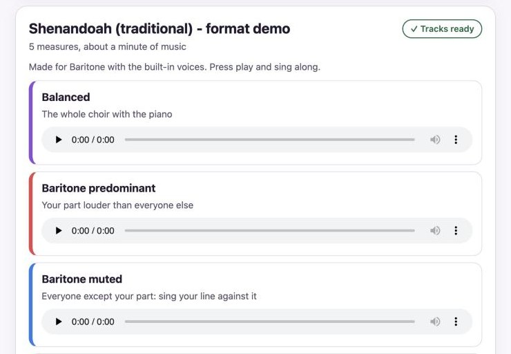
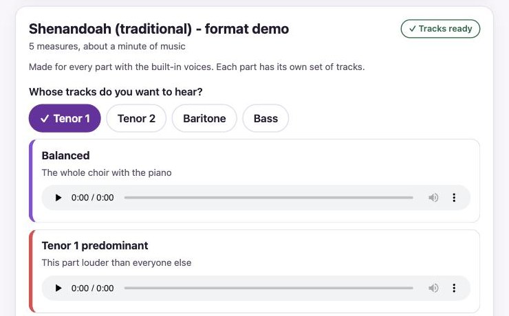
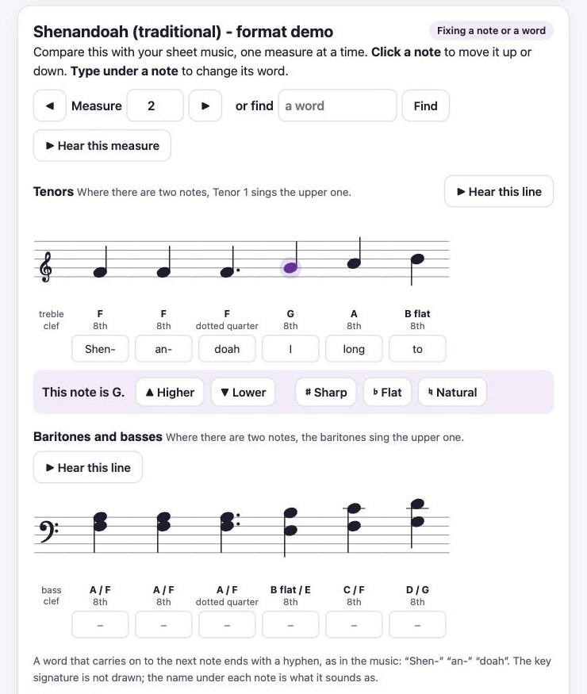

# Palare Piano

**Sheet music in, rehearsal tracks out.**

Give Palare Piano the sheet music for a piece your chorus is singing, tell it which part you
sing, and it makes practice tracks for you: your part louder than the rest, your part left out
so you can sing against the others, and your part all by itself. It is for tenor and bass
choruses (Tenor 1, Tenor 2, Baritone, Bass).

It runs on your own Mac. Your music is never sent anywhere.



---

## Before you start

You need:

- **A Mac with an Apple chip, running macOS 14 or newer.** To check: click the Apple logo at the
  top-left corner of your screen, then **About This Mac**. Next to **Chip** it should say
  *Apple M1* (or M2, M3 and so on). Next to **macOS** the number should be 14 or higher. If it
  says *Intel*, this will not work on your Mac.
- **An internet connection** while it installs.
- **About 2 GB of free space** (and 5 GB more if you later add real voices).
- **About 10 minutes.**

You do not need to know anything about computers beyond clicking, typing and copy-and-paste.

**No suitable Mac?** You may not need one. Someone in your chorus who has one can make the tracks
for every part and send them round: see [Make tracks for your whole chorus](#make-tracks-for-your-whole-chorus).
To play them you only need a phone.

## Install it (once)

You will paste one line of text into a program called Terminal. It looks technical; it is only
three steps, and you never have to do it again.

**1. Open Terminal.**
Hold down the **Command** key (⌘, next to the space bar) and press the **space bar**. A search
box appears. Type `Terminal` and press **Return** (the big key on the right; some keyboards
call it Enter). A plain window with some text opens. That is Terminal.

**2. Copy this line.**
Move your mouse over the grey box below. A small copy button appears at its right end: click
it. (Or select the whole line and press ⌘C.)

```
curl -fsSL https://raw.githubusercontent.com/BillReyor/Palare-Piano/main/install.sh | sh
```

**3. Paste it into Terminal and press Return.**
Click once inside the Terminal window, press **⌘V** to paste, then press **Return**.

Now wait. Terminal prints what it is doing. It is finished when it says
**"Palare Piano is installed."** and a page opens in your web browser. You can then close
Terminal.

> **If a window from Apple pops up** asking to install "command line developer tools", click
> **Install** (and **Agree** if it asks). This is a normal, free part of macOS that Palare Piano
> needs. It can take 15 minutes. When it finishes, the Terminal window carries on by itself.

It does not ask for your password and does not change anything else on your Mac.

## Open it next time

Palare Piano is now an app on your Mac.

1. Hold **Command** (⌘) and press the **space bar**.
2. Type `Palare Piano` and press **Return**.

It opens as a page in your web browser (Safari, Chrome or whichever you use). It is not a
website: it is running on your own Mac, and it works without the internet.

You can also find it in **Finder**: click **Go** in the menu bar at the top of the screen, then
**Home**, then open the **Applications** folder you see there.

## Make your first tracks

**1. Add your sheet music.**
Click **Add your sheet music** and choose the PDF, or drag the PDF onto the page. A PDF from your
director works best. A scan or a photo-copy saved as a PDF works too.

No PDF handy? Click **Try a short demo first**.

**2. Wait while it reads the music.**
A few seconds for a clean PDF; about half a minute for each page of a scan.

**3. Choose your part, and how it should sound.**



- **Quick listen** takes about a minute. The voices are clear but sound like a machine. Good for
  checking your notes.
- **Real voices** sound like people singing, and take much longer (see below).

**4. Click "Make my tracks".**
You can leave it working and close the window. It carries on.

**5. Press play and sing along.**



| Track | What you hear |
|---|---|
| **Balanced** | The whole choir with the piano |
| **Your part predominant** | Your part louder than everyone else |
| **Your part muted** | Everyone except your part, so you can sing your line against them |
| **Your part alone** | Just your part |
| **Voices only** | The choir without the piano |

## Put the tracks on your phone

Click **Show the files in Finder**. A folder opens with your tracks in it. From there:

- **AirDrop:** select the tracks, right-click, choose **Share**, then **AirDrop**, then your
  iPhone.
- Or drag them into an email or message to yourself.

All your pieces are kept in the **Music** folder on your Mac, inside a folder called
**Palare Piano**.

## What will work on my computer?

The first time it opens, Palare Piano tries your computer out for a few seconds. Near the bottom
of the page, **What this computer can do** then lists each thing with a tick, a "works, slowly"
or a cross, and how long a three-minute piece will take. Anything that will not work on your
computer is switched off in the choices, with the reason.

If real voices will not work on your Mac, you can still use **Quick listen**, or ask someone
with a newer Mac to make the tracks for everyone (next section).

## Make tracks for your whole chorus

One person can make the tracks for everybody, so that nobody else has to install anything.

1. Under **Which part do you sing?** choose **Every part, to share**.
2. Make the tracks as usual. It takes hardly any longer than making one part.
3. Click **Get the files to share**. A folder opens with one zip file for each part.
4. Send each section its file: by email, by AirDrop, or in a shared folder (Google Drive, Dropbox,
   iCloud).

Each singer opens their section's file on a phone or a computer and presses play. Every file
holds the same five tracks, made for that part.



## Real voices (optional)

Out of the box, the choir is sung by built-in voices. You can add real recorded voices so the
tracks sound like people singing.

- On the Palare Piano page, click **Add real voices**. It is a 4 GB download, once.
- After that, choose **Real voices** when you make your tracks.
- Real-voice tracks are slow to make: roughly **ten minutes for every minute of music** with the
  full choir, about a third of that with the small choir. Start it, leave your Mac plugged in,
  and come back later.

## If something is not right

**"The reader was unsure about some places."**
Normal, especially for scans, and most pieces still come out fine. To check them, click **Go
through them, one by one**. Each place opens in the music with a plain sentence saying what the
reader was unsure of, and the notes in question marked in yellow. Put it right there, or click
**It is right as it is**, and it moves on to the next.

**A note or a word is wrong.**
You can fix it on the page, with your sheet music beside you:

1. Under the piece, click **Fix a note or a word**.
2. Go to the measure: type its number, use the arrows, or type a word from the lyrics and click
   **Find**. Each measure is drawn the way it looks in your music.
3. **A wrong note:** click it, then click **Higher** or **Lower** until it sits where your
   music has it. Sharp, flat and natural are there too. You hear the note each time.
4. **A wrong word:** type the right one in the box under its note.
5. Click **Hear this measure** to check it, then **Done**, then **Make the tracks again**. Only
   what you changed is sung again.



**Undo all my changes** puts everything back as it was first read.

**"No tempo is printed in this music."**
Type the tempo your director takes (beats a minute) into the box and click **Set the tempo**.

**"This could not be read as music."**
The PDF may not be a tenor and bass choir score, or the scan may be too faint or crooked. Try a
cleaner copy.

**It is taking a very long time.**
Real voices are slow; the page shows how much is left. A long piece with the full choir can take
over an hour. Use **Quick listen** when you are in a hurry.

**I closed the page. Where did it go?**
Open Palare Piano again the same way (⌘ and space bar, type `Palare Piano`, Return). Anything it
was making has carried on.

**How do I update it?**
Do the three install steps again. Your pieces and tracks are kept. If Palare Piano is in the
middle of making tracks, let it finish first.

**How do I remove it?**
Do the install steps again, but paste this line instead. Your pieces and tracks stay in your
Music folder.

```
curl -fsSL https://raw.githubusercontent.com/BillReyor/Palare-Piano/main/install.sh | sh -s -- --uninstall
```

## Good to know

- **It is a practice aid, not a performance.** It reads the page and sings what it finds. It
  can misread a note or a word, more often on scans.
- **Tenor and bass choirs only** (four parts, or three), with piano or unaccompanied.
- **English and church Latin.** Other languages are sung as if spelled in English.
- **Your music stays on your Mac.** The internet is used only to download Palare Piano itself
  and, if you add them, the real voices.
- **Sharing tracks made with real voices?** Each piece's folder has a small file called
  *Credits*. Keep it with the tracks: the voices belong to real singers who allowed their use on
  that condition.

## More

- [About Palare Piano](docs/about.md): what it cannot do, the story behind the name, credits and
  licence.
- [Other computers, and the command line](docs/install-by-hand.md), for the technically minded.
- [How it works](docs/how-it-works.md) and [the record of how it was made](docs/journal.md).

Palare Piano is free software under the [GNU General Public License, version 3](LICENSE).
*A practice track is for learning your part. The singing stays with the singers.*
